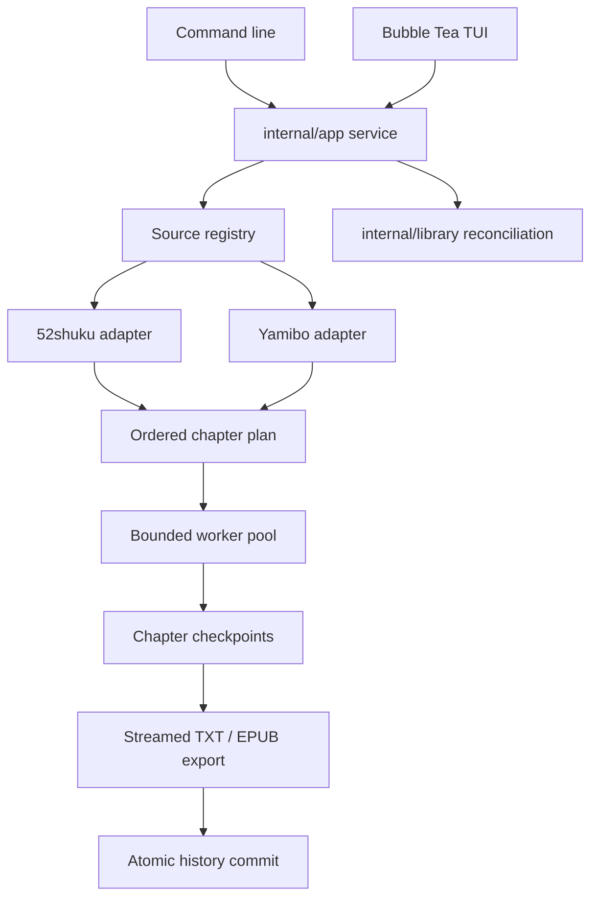

# YuriScraper Architecture

YuriScraper is a multi-source terminal downloader with two front ends over one
application service: a Bubble Tea TUI for browsing and a command line for
scripting. Site parsers, task scheduling, converters, and local persistence are
independent of the interface so that adding a source or a client does not
duplicate the application.

## Runtime flow



The service selects exactly one source for each search. Public sources go
straight to search; authenticated sources implement `CredentialsAuthenticator`
and receive credentials from the in-memory TUI form or the terminal prompt.

## Package responsibilities

| Path | Responsibility |
|---|---|
| `cmd/yuri_scraper` | Command routing, flags, exit codes, installer entry, program startup |
| `internal/app` | Search/plan/download use cases, one active task, cancellation, history commit |
| `internal/tui` | List/text/modal contexts, layouts, theme, skippable startup screen |
| `internal/library` | Reconciles history with reader files; open, reveal, recoverable trash |
| `internal/install` | Builds and atomically installs a user-level command and config locator |
| `internal/diagnostics` | Private bounded JSONL logs, safe failure classification, recovery guidance |
| `internal/search` | Shared domain types, source interfaces, fuzzy ranking |
| `internal/search/sites` | Site-specific HTTP and HTML parsing, source policies |
| `internal/transport` | Bounded HTTP transport and retryable/permanent error classification |
| `internal/scraper` | Worker scheduling, rate limiting, retries, checkpoints, export orchestration |
| `internal/converter` | Chapter splitting, zh conversion, streamed TXT and EPUB output |
| `internal/store` | Configuration, atomic JSON history, library lock, path resolution |
| `internal/buildinfo` | Version normalization and user-visible build identity |

Dependency rule: `tui` and `cmd` call `app`; `app` calls `search`/`scraper`/
`store`/`library`. No business package imports Bubble Tea, and no source
adapter writes metadata or decides file paths.

## Source interfaces

Every source implements the small common protocol:

```go
type SiteAdapter interface {
    Name() string
    BaseURL() string
    Search(context.Context, string) ([]SearchResult, error)
    GetChapterList(context.Context, string) ([]Chapter, error)
    GetChapterContent(context.Context, string) (string, error)
}
```

Optional capabilities keep public sources simple:

```go
type CredentialsAuthenticator interface {
    RequiresAuthentication() bool
    IsAuthenticated() bool
    Login(context.Context, string, string) error
}

type ScopedSearcher interface {
    SearchScopes() []SearchScope
    SearchScoped(context.Context, string, []string) ([]SearchResult, error)
}

type BookMetaProvider interface {
    GetBookMeta(context.Context, string) (*BookMetaDetail, error)
}

type ScrapePolicyProvider interface {
    MaxConcurrency() int64
    MaxRequestsPerSecond() float64
}
```

52shuku supplies rich metadata. Yamibo reads the Discuz login formhash, submits
the account/password form, retains only the resulting in-memory cookie jar, and
maps forum threads/catalog links onto the shared book/chapter representation.
Its search queries literature/translation scopes using both reply and view
ordering, merges threads by TID, and emits reply/view popularity signals. The
shared search package owns query variants, CJK fuzzy relevance, and bounded
popularity weighting, so site adapters do not duplicate ranking.

Yamibo additionally implements the optional `ChapterPlanner` protocol with two
separate resolvers: a catalog resolver that extracts and scores independent DOM
candidates with previews, and an author-post resolver that detects or accepts an
author, discovers total pages, scans within a configured limit, and deduplicates
ordered posts by PID. Paging state is persisted as a credential-free JSON
checkpoint, and post bodies found while planning are streamed through a content
sink into the normal chapter cache so the worker pool neither re-fetches them
nor retains the whole book.

## Request budget

`ScrapePolicyProvider` declares a source ceiling; the configured values stay
authoritative below it.

| Source | Effective budget |
|---|---|
| 52shuku | configured `concurrency`/`rate_limit`, capped at 64 workers and 20 req/s |
| Yamibo | configured values, capped at 2 workers and 1.2 req/s |

`transport.BoundedTransport` owns the request budget for a source: a slot is
held until the response body closes, the token bucket covers redirect hops, and
decoded bodies are bounded. A response larger than the cap is a permanent error
rather than a silently truncated page.

A token bucket alone releases requests at perfectly even intervals, which is a
detectable machine signature and offers no protection against a per-IP rate
heuristic. The transport therefore also enforces a randomized minimum spacing
between releases: consecutive requests are separated by at least the configured
interval and at most 1.5x it. Spacing is derived from the interval itself, so it
scales with any configured rate and applies to every source. It can only make a
sequence slower than the configured budget, never faster, and it never delays
the first request that the token bucket permits.

Every attempt, including retries, waits on the same token bucket. Retry delays
use exponential backoff capped at 30 seconds plus small deterministic jitter.
`Transport.HTTPError` carries status codes and `Retry-After`; the error
classifier retries only temporary network failures and an explicit set of status
codes. Unknown parser failures are permanent, so a changed site fails fast
instead of hammering the source.

## TUI state machine

```mermaid
stateDiagram-v2
    [*] --> Startup
    Startup --> Results: flower, then YURI wordmark; timeout or any key
    Sources --> Auth: authenticated source
    Sources --> Results: public source
    Auth --> Results: login succeeds
    Results --> Search: slash or i
    Search --> Results: Enter or Esc
    Results --> Progress: Enter or p
    Progress --> Results: Esc
    Results --> Library: b
    Library --> Progress: r
```



`navigation.go` owns key routing per context, `commands.go` owns asynchronous
Bubble Tea commands, `model.go` owns state transitions, and `view.go` owns
layout. Search results remain in memory while a book downloads, so returning
from the task view restores the query, the full result list, and the cursor.
A cancelled or failed run reports an explicit state and never silently becomes a
success.

### TUI layout and handoff invariants

- `view.go` reserves eight terminal rows for outer margins, header/navigation,
  border and fixed status/key bars. Content width is terminal width minus six
  cells. Never use byte or rune length for layout: ANSI/CJK widths use Lip Gloss
  and `ansi.Truncate`; wide previews begin at 100 terminal columns.
- `viewOffset` pages long help, diagnostics, task, planning and detail content.
  List windows follow the cursor; a short window removes secondary headings
  instead of hiding the selected row. Window changes recalculate input widths.
- The original YURI block wordmark is retained. `startup.go` shows the white/
  yellow lily for 650 ms, then the white/yellow wordmark for 950 ms. The main
  header uses the Unicode lily emblem; terminal fonts are not changed.
- Do not assign `activeBook` before rejecting a second active task. `x` cancels
  both the service and the pending `taskCancel` context, so cancellation before
  the asynchronous `Start` cannot be lost. Failed planning/export with zero
  failed chapters must still allow `r` retry.
- Search completion updates data without changing a newer input context.
  Failed searches retain the last list; retry/cancel uses request IDs to reject
  stale replies. Deletion confirmation captures `deleteEntry`, not a mutable
  list index; a background library refresh must never change its target.
- Maintain `README_zh.md`, the English README and release notes alongside each
  significant change. Record actual verification and limits, not intended
  checks; this section is the handoff contract for later agents.

### Diagnostics and recovery

`Run` owns the process logger for CLI and TUI and restores the previous logger
on return. Default JSONL events cover sessions, search outcome, failed 52shuku
requests and task lifecycle. `--debug` enables successful-request timing/status.
Only endpoint host/path is logged; query strings, credentials, headers and
bodies are excluded. `diagnostics.Failure` uses typed allowlisted attributes,
never arbitrary `err.Error()`; the original error is visible locally in the
TUI's `!` panel or CLI stderr.

The current `.diagnostics.log` and one `.1` backup are limited to 2 MiB each with
0600 permissions; rotation serializes writes within the process. `logs` and the
TUI reader read at most 64 KiB / 100 lines without creating a log. Opening a log
failure produces an explicit warning and does not prevent use of the app.
Recovery is user-controlled: `r` retries, `x` cancels, `Esc` returns, and existing
results/cache survive. No automatic source switch or access-control bypass.

Configuration lookup still honors the installed locator, but an unavailable
selected configuration is now an error rather than silently using defaults in
a different library. Source installation determines its build root independently
of that locator (`--root`, embedded root, then current directory).

## Task lifecycle

`internal/app.Service` owns one active book per process and output directory.

1. `Start` (or `Retry`) validates the book, acquires the library lock, creates a
   fresh `scraper.Engine`, and launches the coordinator goroutine.
2. The engine resolves the chapter plan, downloads through the bounded pool, and
   reports cumulative progress; intermediate events may be coalesced but the
   terminal event is always delivered.
3. On completion the service writes exactly one history entry for the source,
   book URL, and format, releases the lock, and publishes the final snapshot.
4. `Cancel` cancels the job context; committed checkpoints remain, so the next
   run resumes from the cache. `Wait` lets an interface restore the terminal
   only after the job releases its files.

A second process for the same output directory fails with an explicit
library-busy error rather than racing for metadata. The lock is advisory and
per-directory; it is not a distributed transaction.

## Checkpoints, partial failure, and export

Successful chapter responses are atomically written to:

```text
<output>/.cache/<book-hash>/<chapter-url-hash>.txt
```

This means successful chapters need no second network request, retrying a
partial book only fetches missing chapters, and the worker pool never holds
every chapter body at once.

Export streams chapters in plan order through `converter.WriteTXTStream` or
`converter.WriteEPUBStream`. Only navigation titles and filenames are retained
until the EPUB package metadata is written, and each chapter is flushed so a
failing destination stops the producer. Failed chapters appear in the output as
explicit markers and in `<book>-<hash>.failed.json`; the cache and manifest are
removed only after a fully successful export.

Finished files and failure manifests use a source/book identity suffix, so two
books with the same title cannot overwrite each other. Output, history, and
checkpoints are written to a temporary file, synced, and renamed.

## Command line contract

`yuri-scraper [--config FILE] [--output-dir DIR] COMMAND [OPTIONS]`; running
without a command opens the TUI. Results go to stdout, diagnostics and progress
to stderr, and `--json` writes machine-readable output only. Exit codes are
`0` success, `1` failure, `2` usage error, `3` partial download, `130` canceled.
`config show --json` reports the effective configuration, including the output
directory after resolution.

Configuration resolution order: `--config`, `YURI_SCRAPER_CONFIG`, the locator
written by `install`, the checkout containing the running binary, a
recognisable `config.yaml` beside the binary, then the project root or
configuration file of the current directory. Relative `output_dir` resolves
against the configuration file.

## Release pipeline

The repository contains source code, not compiled platform binaries.

- `ci.yml`: short unit tests, `go vet`, native build;
- `release.yml`: validates the tag against `release/VERSION`, then cross-compiles
  five targets with `CGO_ENABLED=0` and attaches them with a SHA-256 manifest;
- the version is injected with `-X main.Version=<version>`.

## Next integration work

- add fixtures when Yamibo exposes materially different historical themes;
- surface incremental planner progress through Bubble Tea messages;
- verify account login and scoped search against representative live threads
  without persisting credentials;
- measure peak memory and request counts for a genuinely large book and record
  the numbers here;
- add more source policies once a real site requests one.

Android remains a separate Kotlin/Compose client. It may share domain
terminology, fixtures, and the JSON contracts of `--json` output with the PC
application, but forcing Go/Kotlin runtime sharing would add more packaging
complexity than it removes. The application service boundary exists so a future
client reuses the use cases, not the terminal rendering.
