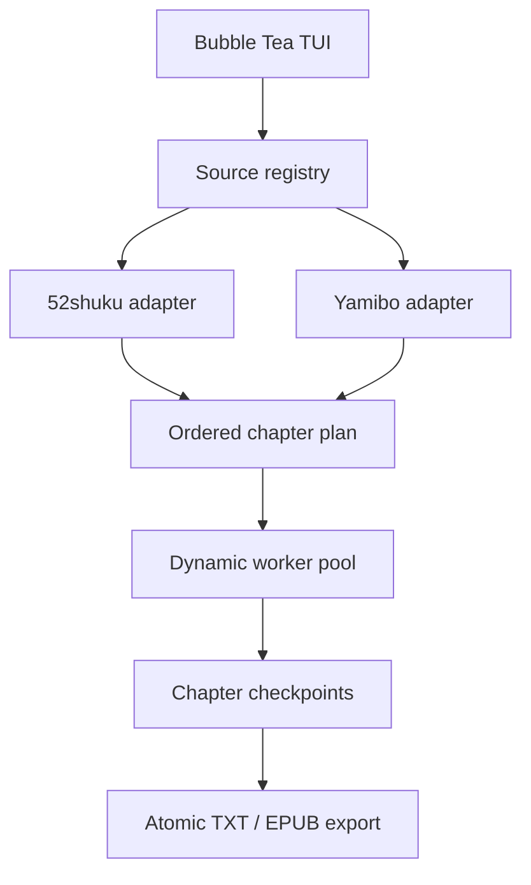
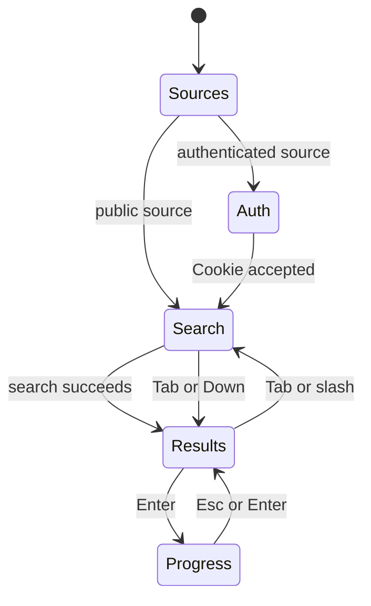

# YuriScraper v0.6 Architecture

YuriScraper is a multi-source PC terminal application. The TUI, site-specific
parsers, download scheduler, converters, and local persistence are separated so
that adding a source does not duplicate the entire application.

## Runtime flow



The TUI selects exactly one source for each search. Public sources continue
directly to search; authenticated sources implement `CookieAuthenticator` and
receive credentials from the in-memory TUI authentication view.

## Package responsibilities

| Path | Responsibility |
|---|---|
| `cmd/yuri_scraper` | Configuration, source registration, program startup |
| `internal/tui` | Source/auth/search/result/progress/library state machine |
| `internal/search` | Shared domain types, source interfaces, fuzzy ranking |
| `internal/search/sites` | Site-specific HTTP and HTML parsing |
| `internal/scraper` | Worker scheduling, rate limiting, retries, checkpoints |
| `internal/converter` | Chapter splitting, zh conversion, TXT and EPUB output |
| `internal/store` | YAML configuration and atomic JSON history |

## Source interfaces

Every source implements the small common protocol:

```go
type SiteAdapter interface {
    Name() string
    BaseURL() string
    Search(context.Context, string) ([]SearchResult, error)
    GetChapterList(context.Context, string) ([]Chapter, error)
    GetChapterContent(context.Context, string) (string, error)
}
```

Optional capabilities keep public sources simple:

```go
type CookieAuthenticator interface {
    RequiresCookie() bool
    HasCookie() bool
    SetCookie(string)
}

type BookMetaProvider interface {
    GetBookMeta(context.Context, string) (*BookMetaDetail, error)
}
```

52shuku supplies rich metadata. Yamibo implements cookie authentication and
maps forum threads/catalog links onto the shared book/chapter representation.

## TUI state machine



Search results remain in memory while a book downloads. This is why returning
from progress restores the author/title result list instead of resetting the
cursor to the search input.

## Download scheduler

The scheduler creates a bounded pool once per book. A worker checks the current
atomic concurrency target before taking another task. `SetSpeed` updates both:

| Profile | Workers | Request rate |
|---|---:|---:|
| Slow | 2 | 0.5 req/s |
| Normal | 8 | 2 req/s |
| Fast | 16 | 5 req/s |

Every attempt, including retries, waits on the token bucket. Retry delays use
exponential backoff capped at 30 seconds plus a small deterministic jitter.
Idle time cannot accumulate a large burst. Sources may implement
`ScrapePolicyProvider`; Yamibo caps the profiles at two workers and 1.2 req/s.

## Checkpoints and partial failure

Successful chapter responses are atomically written to:

```text
<output>/.cache/<book-hash>/<chapter-url-hash>.txt
```

This has three effects:

1. successful chapters do not need another network request after interruption;
2. retrying a partial book only downloads missing chapters;
3. the worker pool does not retain every chapter body simultaneously.

If one or more chapters fail, YuriScraper still creates the requested ebook
with visible failure markers and writes `<book>.failed.json`. Pressing `R` runs
the book again; cached chapters are reused. The cache and manifest are removed
only after a fully successful export.

TXT and EPUB output are first written to `*.tmp`, closed, and renamed. History
uses the same atomic-write pattern and replaces an existing entry for the same
book URL rather than creating duplicates.

## Release pipeline

The repository contains source code, not compiled platform binaries.

- `ci.yml`: short unit tests, `go vet`, native build;
- `release.yml`: cross-compiles with `CGO_ENABLED=0`;
- pushing a `v*` tag creates Windows, Linux and macOS Release artifacts;
- the version is injected with `-X main.Version=<version>`.

## Next integration work

- scan all Yamibo thread pages in author-post mode while preserving post order;
- add fixture-based Yamibo parser tests for multiple forum layouts;
- add optional account/password login without persisting the password;
- expose per-source conservative rate profiles;
- add a migration note and archive the legacy Python PC implementation after
  the Go path has been verified against representative books.

Android remains a separate Kotlin/Compose client for now. It may share visual
language and domain terminology with the PC TUI, but forcing Go/Kotlin runtime
sharing would add more packaging complexity than it removes.
